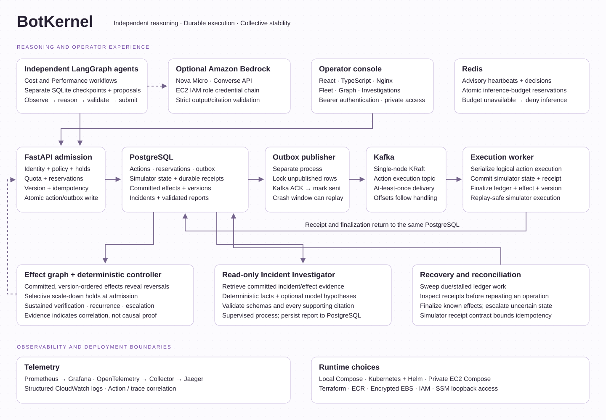

# BotKernel

**Durable execution and collective stability for independent agents.**

Cost and performance agents can each make reasonable decisions and still destabilize a shared resource. BotKernel separates reasoning from execution, records what actually changed, detects opposing effects, and investigates incidents from durable evidence.

[Architecture](docs/ARCHITECTURE.md) | [Engineering results](docs/ENGINEERING_RESULTS.md) | [Demo guide](docs/DEMO_GUIDE.md) | [Validation](docs/VALIDATION.md)

## System architecture



[View full-size diagram](docs/assets/botkernel-system-architecture.svg) · [Architecture details](docs/ARCHITECTURE.md)

## What makes it different

| Concern | Implementation | Boundary |
|---|---|---|
| Independent reasoning | Cost and Performance LangGraph workflows, separate SQLite checkpoints, deterministic or optional Nova Micro providers | Model output is strictly validated and advisory by default |
| Safe admission | Authenticated FastAPI gateway, version checks, policy/holds, quota locks and immutable idempotency keys | PostgreSQL owns execution correctness |
| Durable execution | Transactional action/outbox creation, separate publisher, Kafka workers, receipts and reconciliation | At-least-once messaging; idempotent **simulator** effects |
| Collective reliability | Committed-effect graph, cross-agent reversals, selective scale-down holds, sustained verification, recurrence and escalation | Correlation is evidence, not causal proof |
| Investigation | Supervised read-only evidence retrieval and validated, persisted reports; optional Bedrock analysis | Facts, deterministic inferences and model hypotheses stay distinct |
| Operational evidence | React console, Prometheus/Grafana, OpenTelemetry/Jaeger and structured CloudWatch logs | Actual backend measurements stay separate from virtual experiments |

### Execution flow

1. An agent observes simulator telemetry and forms a bounded proposal.
2. FastAPI validates identity, policy, quota, resource version and idempotency. PostgreSQL commits the reservation, action and outbox together.
3. The publisher delivers to Kafka and marks publication after acknowledgement. Replays remain possible across crashes.
4. A worker records the simulator receipt/effect, then finalizes the ledger, committed-effect record and resource version. Recovery reconciles uncertain outcomes rather than guessing.
5. The deterministic controller reads committed effects and applies resource-specific containment. The Investigator retrieves the incident's evidence and saves a report.

A model never calls AWS infrastructure tools or authorizes its own rejected action. [Reliability guarantees and limitations](docs/FAILURE_RECOVERY.md)

## Verified engineering results

**990/990 logical simulator actions** (912 measured + 78 warmups) completed across 18 bounded PostgreSQL/Kafka runs, each with one published outbox, receipt and effect and consistent resource versions.

An interleaved three-repeat experiment compared default 200-ms publisher polling with opt-in 20-ms polling:

| Actions / clients | Effects/s, 200 -> 20 ms | Completion p95 ms, 200 -> 20 ms |
|---|---:|---:|
| 24 / 1 | 4.717 -> 10.465 | 259.402 -> 120.842 |
| 48 / 4 | 14.762 -> 25.205 | 382.406 -> 222.237 |
| 80 / 8 | 12.723 -> 12.337 | 815.305 -> 927.094 |

These are medians of three short, instrumented runs on a contended 12-vCPU/7.58-GiB Docker engine, not capacity limits. Faster polling raised sampled publisher CPU and worsened the eight-client tail; **the default remains unchanged**. [Raw distributions, stage timings and environment](docs/ENGINEERING_RESULTS.md).

**Five fault-injection cases** recovered with one effect/version increment per action and zero unresolved actions, including worker death after receipt and publisher death after broker ACK. The complete current-source backend suite passed **255 tests with one skip**. [Reproduce and inspect](docs/VALIDATION.md).


The controller comparison also retains unfavorable results: in some modeled scenarios, fewer reversals came with longer containment, higher latency, lower throughput and worse false-positive occupancy. Episode-level detection and tick-level alarm occupancy are reported separately. [Full methodology and tradeoffs](docs/BENCHMARKS.md)

### Bounded AWS and Bedrock acceptance

On **2026-11-14**, the private EC2/Compose deployment completed an eight-action distributed scenario, sustained recovery verification and recurrence. Including its preparatory action, **9/9 actions** each had one published outbox row, receipt and committed effect; the database held **24 total effects** afterward.

Cost and Performance received genuine Nova Micro advisory NO_OP decisions. The Investigator persisted a genuine model-backed report after one retained validation failure and a tested prompt correction: **three workflows verified across four new calls**, with returned usage and request provenance. This proves integration and contract validation, not optimal recommendations. No model-controlled action executed.

All five Prometheus targets were healthy; a 14-span API/publisher/worker trace and matching CloudWatch logs correlated a demonstrated action. The authenticated AWS dashboard and its five console views were exercised privately. **The instance was stopped afterward; this is historical validation, not an always-on public service.** [Evidence and qualifications](docs/VALIDATION.md)

## Operator console

The React/TypeScript console includes Mission Control, Agent Fleet, the Effect Graph, Investigations and Experiment Lab. Operational views use API data, with truthful disconnected/loading/empty states. The public landing animation is illustrative; capacity and latency in experiments are modeled simulator values.

Authentication uses an operator bearer credential retained only in browser memory. Agents have a separate restricted credential, and Prometheus has a separate metrics credential. Keep the service private; bearer authentication is not a substitute for network isolation or a full multi-user authorization system.

## Run locally

Prerequisites: Python 3.12, Docker Compose v2, Node.js 24 and sufficient free Docker memory. Follow [local setup](docs/LOCAL_SETUP.md) to create an ignored `.env` with three independent high-entropy credentials. Never overwrite an existing environment or stop another project to make room without reviewing ownership.

```powershell
# After creating .env from .env.example and configuring the credentials:
docker compose -p botkernel-demo --profile stability up --build -d postgres redis kafka init api publisher worker recovery controller
npm --prefix apps/dashboard ci
npm --prefix apps/dashboard run dev
```

Open the Vite URL printed in the terminal. The example API target is `http://127.0.0.1:18019`; the frontend proxy reads `BOTKERNEL_API_TARGET` from the repository `.env`. Sign in privately with the configured operator credential.

Use [the bounded demo guide](docs/DEMO_GUIDE.md) for actual proposals, controller evidence and investigation. Run agents deliberately with bounded cycles; do not start paid inference loops. For a non-destructive stop:

```powershell
docker compose -p botkernel-demo --profile stability stop
```

Do not use volume deletion or pruning as recovery.

## Reproduce the evidence

| Task | Entry point |
|---|---|
| PostgreSQL/Kafka tests | `docker compose -p bk-validation --profile test run --build --rm tests` after its private dependencies are ready |
| Frontend checks | `npm --prefix apps/dashboard test` and `npm --prefix apps/dashboard run build` |
| Real execution benchmarks | [Benchmark methodology and commands](docs/BENCHMARKS.md) |
| Recovery/duplicate delivery | [Fault-injection evidence](docs/ENGINEERING_RESULTS.md#durability-and-recovery) |
| Seeded controller comparisons | `python -m botkernel.evaluation` | virtual simulation, not Kafka performance |
| Local Kubernetes | [Helm runtime procedure](infra/kubernetes/README.md) | runtime acceptance pending |
| Private AWS demonstration | [Terraform/deployment guide](infra/terraform/README.md) | opt-in; no resources created by local startup |

The CI workflow is included in the repository; local results are not a claim that remote GitHub Actions has run or passed.

## Technology

**Execution:** Python, FastAPI, Pydantic, PostgreSQL, SQLAlchemy/Alembic, Kafka, Redis.
**Agents:** LangGraph, SQLite checkpoints, optional Amazon Bedrock Runtime Converse.
**Console:** React, TypeScript, Vite, Tailwind, shadcn/ui, React Flow, Recharts, Motion.
**Operations:** Docker Compose, Terraform, EC2, ECR, encrypted EBS, IAM, SSM, CloudWatch, Prometheus, Grafana, OpenTelemetry and Jaeger.
**Alternative local runtime:** Kubernetes and Helm; static validation is complete, live deployment is not yet verified.

## Security and limits

- Cloud deployment, paid inference and AI action execution are disabled by default. The controller is deterministic and has no real infrastructure-remediation tools.
- The AWS demonstration is single-host; PostgreSQL and Kafka are single-node, without HA/failover. Operator access is private through SSM, not public ingress.
- Simulator receipts support idempotent reconciliation; they do not guarantee exactly-once external execution for arbitrary services.
- SQLite ownership locks are validated on local Linux storage, not as a distributed or network-filesystem ownership protocol.
- Bedrock call/token reservations fail closed through shared Redis state. Estimates are application guards, not AWS billing caps; ambiguous invocations are not automatically retried.
- Backup artifacts were preserved, but a disaster-recovery restore drill has not been validated. A PVC or retained EBS volume is not a backup strategy.
- Shared-host benchmark results include instrumentation and competing workloads. They are qualified measurements, not peak throughput or production SLOs.

## Documentation

[Architecture](docs/ARCHITECTURE.md) | [Engineering results](docs/ENGINEERING_RESULTS.md) | [Benchmarks](docs/BENCHMARKS.md) | [Controller](docs/COLLECTIVE_STABILITY_ALGORITHM.md) | [LangGraph](docs/LANGGRAPH.md) | [Bedrock](docs/BEDROCK_ACCEPTANCE.md) | [Observability](docs/OBSERVABILITY.md) | [Docs index](docs/DOCS_INDEX.md)

### License

No `LICENSE` file has been added. No license or permission beyond applicable law and GitHub's terms is implied.
