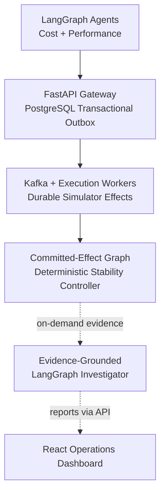

# BotKernel

**Evidence-driven coordination and reliability for independently operating agents.**

BotKernel is a distributed AgentOps platform for detecting and containing harmful interactions between autonomous agents sharing infrastructure. It combines durable action execution, a deterministic Collective Stability Controller, evidence-grounded incident investigation, and an operator dashboard. Unlike a chatbot or agent-framework demo, its core contribution is controlling shared-system side effects and retaining evidence across asynchronous execution.

> **Implementation status:** Local PostgreSQL/Kafka execution, simulator, stability controller, deterministic agents/investigator, and dashboard are implemented. Bedrock integration exists behind explicit gates, but live inference has not been verified. AWS state may be stale or unknown. Do not infer cloud deployment readiness from historical notes.

## Architecture



Dashed arrows indicate on-demand evidence and report access, not automatic execution; the dashboard also reads operational data independently via the API. PostgreSQL owns correctness; Kafka is at-least-once, with retries, replay and reconciliation for ambiguous effects. Redis is advisory, not a correctness authority or billing cap. Bedrock is optional; Prometheus, Grafana, OpenTelemetry and Jaeger provide observability, and Terraform describes an optional private AWS deployment. See [architecture details](docs/ARCHITECTURE.md).

## Execution and recovery

1. Agents observe simulator telemetry and produce a proposal (deterministic by default).
2. FastAPI validates role, resource and capacity constraints; PostgreSQL atomically commits admission, reservation, ledger and outbox state.
3. The publisher emits outbox events to Kafka; workers execute the simulated effect and persist receipts/effects.
4. The controller analyzes committed cross-agent effects, applies targeted interventions, monitors sustained recovery, and persists incident lifecycle transitions.
5. The investigator retrieves persisted evidence before optional analysis and saves a validated report. Reports are advisory; investigation does not remediate resources.
6. The dashboard renders API-backed operations, graph, incidents and experiments.

## Capabilities and limits

| Area | Implemented behavior | Qualification |
|---|---|---|
| Durable execution | PostgreSQL ledger, quota/reservation admission, transactional outbox, Kafka workers, recovery | Simulator effects; at-least-once delivery, not universal exactly-once |
| Agents | Independent LangGraph Cost and Performance workflows | Deterministic providers are default; model proposals remain advisory when action execution is disabled |
| Stability | Committed-effect graph, directional reversal evidence, selective holds, recovery verification and recurrence handling | Deterministic controller; evaluated in simulation, not production-scale proof |
| Investigation | Evidence retrieval, citation validation, persisted reports and idempotent request handling | Deterministic by default; live Bedrock inference unverified |
| Dashboard | Landing, Mission Control, Agent Fleet, Effect Graph, Investigations, Experiment Lab | Operator API is unauthenticated; keep private/loopback |
| Observability | Prometheus/Grafana and OpenTelemetry/Jaeger integrations | See [observability notes](docs/OBSERVABILITY.md) for scope |
| Deployment | Docker Compose, Terraform/private AWS assets and local Kubernetes Helm templates | Historical AWS state is not a current-state assertion; Kubernetes runtime is unverified |

## Evaluation

BotKernel includes seeded discrete-event controller comparisons and a PostgreSQL/Kafka real-system benchmark. Simulation metrics describe modeled scenarios, not production detection accuracy. Real-system numbers are single-host observations and must be read with their workload, uncertainty, and limitations in [BENCHMARKS.md](docs/BENCHMARKS.md) and [BENCHMARK_AUDIT.md](docs/BENCHMARK_AUDIT.md). Do not compare simulated throughput with measured database/Kafka throughput.

The retained local PostgreSQL/Kafka runs measured 25 actions at concurrency 1, 50 at concurrency 5, and 100 at concurrency 10. Observed committed-effect throughput ranged from **2.704 to 3.585 effects/s**; admission p95 ranged from **175 to 1,915 ms**, and completion p95 from **538 to 4,382 ms**. These are single-host measurements; the benchmark does not measure stage latency, consumer lag, or peak CPU/memory. See the saved run reports for exact methodology and caveats.

## Technology choices

| Technology | Role |
|---|---|
| Python / FastAPI | Admission API, workers, controller and evidence services |
| LangGraph | Stateful Cost/Performance agent and investigator workflows |
| PostgreSQL | Authoritative ledger, reservations, outbox, effects and reports |
| Kafka | Asynchronous at-least-once event delivery |
| Redis | Advisory coordination and budget state |
| React / TypeScript | Operations dashboard and Experiment Lab |
| Docker Compose | Reproducible local multi-service environment |
| Terraform / AWS | Optional private single-host deployment; current cloud state unknown |
| Prometheus, Grafana, OpenTelemetry, Jaeger | Metrics, dashboards, traces and trace inspection |

## Quick start

Prerequisites: Docker Desktop with Linux containers (or Docker Engine/Compose), Python 3.12 for host tools, and Node.js/npm for the dashboard.

PowerShell (from repository root):

```powershell
$env:BOTKERNEL_API_PORT = '18003'
docker compose -p botkernel-local up --build -d postgres redis kafka init api publisher worker recovery controller
Invoke-RestMethod http://127.0.0.1:18003/ready
```

Then in another terminal:

```powershell
Set-Location apps/dashboard
npm ci
$env:BOTKERNEL_API_TARGET = 'http://127.0.0.1:18003'
npm run dev
```

Open the Vite URL (normally `http://127.0.0.1:5173`). For a bounded Kafka/controller/investigation walkthrough, use `.\scripts\run-live-demo.ps1` from the repository root in an isolated local stack; it writes local demo state. Stop services without deleting volumes:

```powershell
docker compose -p botkernel-local down
```

The dashboard setup is covered in [the dashboard guide](apps/dashboard/README.md); the root Compose files and CI workflow define backend startup and test commands.

## Tests and CI

The project has PostgreSQL/Kafka integration tests, controller/evaluation tests, dashboard Vitest tests, a TypeScript/Vite build, Playwright Chromium tests, and mocked/offline Bedrock acceptance tests. See [CI](.github/workflows/ci.yml), [LangGraph](docs/LANGGRAPH.md), and [Bedrock acceptance](docs/BEDROCK_ACCEPTANCE.md). Local results are not GitHub Actions results; check Actions after an approved publication. CI must remain independent of AWS credentials and paid inference.

## Deployment and optional AI

Local Docker Compose is the supported evaluation path. Terraform and deployment assets target a private AWS demonstration; review [Terraform documentation](infra/terraform/README.md) before any use. Cloud resources can incur charges. Bedrock is optional and disabled by default; live use requires separate authorization, fresh identity/permission/pricing checks, and explicit spend approval. Application token limits are not hard billing caps.

## Security and known limitations

- `AI_ACTION_EXECUTION_ENABLED=false`, `BEDROCK_ENABLED=false`, and spend authorization is disabled by default.
- PostgreSQL is authoritative; Redis is advisory; Kafka is at-least-once.
- Simulator idempotency does not establish exactly-once behavior for arbitrary external side effects.
- The operator API/dashboard has no authentication and must not be exposed publicly.
- Local simulations are not proof of multi-host production reliability.
- Live Bedrock invocation and current AWS deployment state are unverified.
- Investigator cancellation and backup/restore have documented operational limitations.

## Project documentation

- [Architecture](docs/ARCHITECTURE.md) · [Roadmap](docs/ROADMAP.md) · [Collective Stability algorithm](docs/COLLECTIVE_STABILITY_ALGORITHM.md)
- [LangGraph and providers](docs/LANGGRAPH.md) · [Bedrock acceptance](docs/BEDROCK_ACCEPTANCE.md)
- [Benchmarks](docs/BENCHMARKS.md) · [Benchmark audit](docs/BENCHMARK_AUDIT.md) · [Portfolio walkthrough](docs/PORTFOLIO.md)
- [Implementation walkthrough](docs/IMPLEMENTATION_WALKTHROUGH.md) · [Local Kubernetes chart (not runtime-validated)](infra/kubernetes/README.md)

## Rights

Copyright © 2026 Vedant Kesharia. All rights reserved.

This repository is publicly available for portfolio review. No general license is granted for copying, modification, redistribution or commercial use without prior written permission, subject to applicable law and GitHub's terms.
