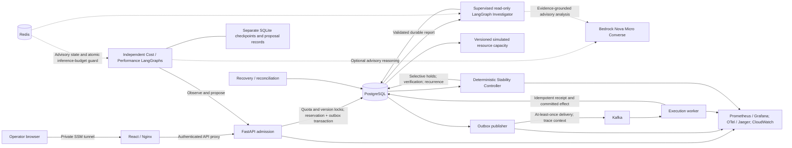

# Architecture

## Verified deployment and execution boundaries (2026-11-14)

The live deployment is one private EC2 host running Docker Compose. It is not
Kubernetes or EKS. The same application has a separate local Helm deployment
definition; local cluster runtime acceptance must be reported independently.

PostgreSQL owns execution correctness. Redis is advisory for heartbeat/decision
state, but the shared inference-budget guard deliberately fails closed when its
Redis state is unavailable. That guard limits application-estimated tokens and
calls; it is not an AWS billing cap. Bedrock cannot change resource state directly.
All demonstrated capacity and latency values describe the simulator, not EC2
resizing or measured cloud latency.

Live evidence now includes valid Cost and Performance advisory model decisions,
a persisted Bedrock Investigator report, and a separate deterministic eight-action
driver run with one published outbox row, receipt and committed effect per action.
The driver is not two autonomous LLM processes. Its incident reached HOLD,
sustained VERIFIED recovery and recurrence; the later observed state was VERIFIED.
A correlated trace includes API, publisher and worker spans. These bounded proofs
do not establish general exactly-once external execution, high availability or
production readiness. See the latest AWS handoff for identifiers, shutdown state
and current verification limitations.

## Local-first system

Independent Cost and Performance agent processes observe simulator telemetry and submit proposals only through FastAPI admission. PostgreSQL owns quotas, resource reservations, the action ledger, the transactional outbox, committed effects, incidents, investigation reports and durable heartbeat timestamps. The publisher sends outbox events to Kafka; workers execute idempotent simulated effects and reconcile ledger state. A recovery worker retries bounded work and escalates ambiguous or exhausted actions. Redis contains advisory heartbeat/decision state and a fail-closed atomic inference-budget guard; PostgreSQL remains the execution correctness authority.

The gateway serializes quota admission and idempotency with PostgreSQL advisory transaction locks. It reserves resource capacity and writes the action/outbox in one transaction. Workers check simulator receipts before replaying effects. Finalization takes the quota lock before changing capacity. The global admission lock is intentionally simple but limits throughput; no production throughput claim is made. Migrations 0001-0009 define the current schema; the root `schema.sql` remains a legacy reference.

The Collective Stability Controller reads committed effects and resource-specific reversal evidence, uses hysteresis and a sustained verification window, applies bounded temporary holds, reopens on recurrence and escalates after its intervention budget. Incident evidence retains initial and latest detection snapshots for reconstruction. The seeded comparison harness is a simulation, not production telemetry or a PostgreSQL/Kafka benchmark; do not claim controller superiority from it.

Cost and Performance agents use separate LangGraph processes and role-specific SQLite checkpoints. The investigator uses deterministic, read-only PostgreSQL evidence collection; optional Bedrock hypotheses are labeled separately from verified facts and deterministic inferences. Model providers have no direct database, Kafka, infrastructure or remediation tools. Any agent proposal still goes through the gateway and deterministic controller.

The investigator uses idempotent PostgreSQL report claims, a fenced lease and a bounded pool of session advisory slots. Evidence statements have a five-second timeout. Each computation runs in a fresh supervised process with a configurable execution deadline and termination grace; the supervisor terminates it and escalates to a forced kill. A timed-out report is fenced and marked failed when PostgreSQL is available. Local process termination remains subject to OS behavior; a lost database session can release a slot while its process is still running, so the slot count is not a strict distributed cap during partitions. An interrupted Bedrock call can have an ambiguous charged outcome and is not automatically repeated.

## Local observability

The optional local Compose profile provides Prometheus, provisioned Grafana, an OpenTelemetry Collector and Jaeger. W3C trace context is persisted through the outbox and Kafka headers. Admission counters are process-local best-effort metrics; ledger and incident data in PostgreSQL remain authoritative. Monitoring storage is local and is not a production retention or access-control design. See [OBSERVABILITY.md](OBSERVABILITY.md).

## AWS single-host deployment model

Terraform and Compose describe an optional private, single-host AWS demonstration using EC2, ECR, CloudWatch Logs and SSM. Bounded AWS live acceptance is recorded in the latest handoff; running/stopped state must always be checked separately. Runtime credentials belong in host-only secret files or an instance role, never in source or images. Operator routes require a bearer credential but application ports must remain private. Review [the Terraform guide](../infra/terraform/README.md) for deployment prerequisites and approval gates. This design is not highly available; backup/restore has not been verified, and cloud storage and runtime can incur charges.

## Local Kubernetes templates

The [local Helm chart](../infra/kubernetes/README.md) defines single-instance stateful services, a migration job, application deployments and optional agents with distinct checkpoint claims. Services are private ClusterIP; database and operator/agent Secrets are supplied separately. Bedrock controls are exposed but default off, and an optional observability profile provisions authenticated Prometheus scraping, Grafana and the existing dashboard files, and Collector/Jaeger tracing. The chart has been linted and rendered, but it has not been installed or validated end to end; it is not an HA or production deployment.

## Runtime limitations

- The console uses a single operator bearer credential in memory; the distinct agent credential is restricted to registration, telemetry, action submission and reconciliation. Authentication does not replace a private network boundary or TLS.
- The Compose broker is a single-node Kafka and the database is a single-host PostgreSQL instance; there is no HA or managed failover.
- Historical single-host AWS demonstrations do not establish current deployment or IAM state.
- Live Bedrock inference, Kubernetes runtime and backup/restore remain unverified.
