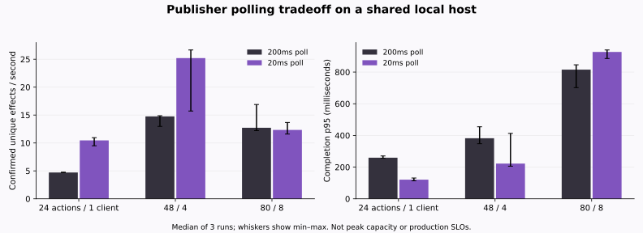

# Engineering results

These are measured outcomes, not production capacity claims. Real distributed-system measurements, virtual controller experiments and historical AWS acceptance are deliberately separate.

## Executive evidence index

| Metric | Measured value / baseline | Environment / sample | Reproduce and inspect | Caveat |
|---|---|---|---|---|
| Durable execution | 990/990 effects including warmups | PostgreSQL/Kafka; 18 runs, 1/4/8 clients | [Raw evidence](../benchmarks/curated/2026-11-14/execution-summary.json), [commands](BENCHMARKS.md) | 912 measured, 78 warmup; shared-host short windows |
| Single-client completion p95 | 259.402 -> 120.842 ms; 53.415% lower | 24 actions; three runs at each poll setting | Same matched benchmark | Publisher CPU higher; eight-client p95 13.711% worse |
| Recovery correctness | 5/5 fault cases, zero unresolved | Separate crash/pause/duplicate matrix | [Fault evidence](../benchmarks/curated/2026-11-14/fault-summary.json) | Simulator idempotency, not arbitrary external exactly-once |
| Concurrent quota/idempotency | 32 HTTP requests, 7 logical effects, 15 duplicate responses, 10 rejections | Local kind; up to 8 concurrent clients; one bounded dataset | [Runtime script](../scripts/kubernetes-runtime-check.py), [raw requests](../benchmarks/curated/kubernetes-2026-11-15/) | Test quota 14; no production capacity or robust tail estimate |
| Kubernetes operations | Pending-worker completion 7.656 s; PG restart 8.484 s; worker rollout 2.734 s; Helm upgrade 15.469 s | Single local kind node; one sample/boundary | [Runtime evidence](KUBERNETES_ACCEPTANCE.md) | Initial probe failures/503 retained; no HA/zero-downtime claim |
| Coordination evaluation | 240 virtual runs; oscillation reversals 47 -> 15 vs basic | 10 seeds x 8 scenarios x 3 policies | [Controller summary](../benchmarks/curated/2026-11-14/controller-summary.json) | Latency/throughput/false-positive regressions included |
| Bedrock integration | Three real workflows across four new requests | Historical bounded EC2 run | [Acceptance](BEDROCK_ACCEPTANCE.md) | Advisory NO_OP agents; one retained validation failure |

[Resume evidence and role-specific selections](RESUME_EVIDENCE.md). Existing benchmark percentages were recalculated from their saved medians; the original 90 hash entries remain unchanged. New Kubernetes evidence has its own manifest.

## End-to-end execution

A predeclared interleaved comparison ran **18 workloads**: 24 actions/1 client, 48/4 and 80/8; three repetitions at each of 200-ms and opt-in 20-ms publisher polling. Each client had one warmup. **912/912 measured actions and 78 warmups** completed with one published outbox row, receipt and effect each; resource versions matched effect counts. All 990 returned HTTP 202, with no rejected/failed/escalated/timed-out measured actions.

Environment: PostgreSQL 16.15, Kafka 3.9.0 (one broker, three partitions), Python 3.12.16; WSL2 Docker engine 12 virtual CPUs/7.58 GiB RAM. Existing competing containers remained running; only new benchmark databases, topics/groups and application containers were created. No AWS or model calls. Tracing and 0.2 s backlog/lag sampling were enabled for both conditions.

Cells below are **medians of three runs**, not pooled action percentiles or confidence intervals. Min/max and per-action samples are retained in the evidence.

| Actions / clients | Poll | Unique effects/s | Admission p50 / p95 / p99 ms | Completion p50 / p95 / p99 ms |
|---|---:|---:|---|---|
| 24 / 1 | 200 ms | 4.717 | 22.701 / 37.984 / 46.403 | 206.695 / 259.402 / 263.407 |
| 24 / 1 | 20 ms | 10.465 | 22.868 / 41.191 / 43.311 | 94.001 / 120.842 / 179.294 |
| 48 / 4 | 200 ms | 14.762 | 40.681 / 84.312 / 122.283 | 264.682 / 382.406 / 428.108 |
| 48 / 4 | 20 ms | 25.205 | 40.991 / 69.303 / 80.103 | 138.318 / 222.237 / 240.569 |
| 80 / 8 | 200 ms | 12.723 | 133.707 / 235.936 / 271.375 | 626.129 / 815.305 / 865.320 |
| 80 / 8 | 20 ms | 12.337 | 137.079 / 279.838 / 345.965 | 601.699 / 927.094 / 994.559 |

### What changed and what did not

A baseline probe observed outbox-wait p95 of 128.203 ms. The publisher previously slept a fixed 200 ms after each poll. `OUTBOX_POLL_INTERVAL_SECONDS` now exposes a bounded 0.01-5 s knob; the default remains 200 ms. The measured 20 ms condition changes no transaction, lock, acknowledgement, reservation, receipt or version invariant. `KAFKA_CONSUMER_GROUP` also permits explicit test isolation; its default remains `executors`.

- **24/1:** throughput 4.717 -> 10.465 effects/s; median run completion p95 259.402 -> 120.842 ms (**53.42% lower**). Admission p95 worsened 37.984 -> 41.191 ms.
- **48/4:** throughput 14.762 -> 25.205 effects/s; completion p95 382.406 -> 222.237 ms. The 20 ms throughput range was 15.722-26.661, showing substantial run-to-run variability.
- **80/8:** throughput 12.723 -> 12.337 effects/s (**3.03% lower**); completion p95 815.305 -> 927.094 ms (**13.71% higher**), with admission p95 also worse. Faster polling is not a universal improvement.

The publisher's pooled sampled median CPU rose 2.64 -> 13.39% of one core (about 5.1 times). API/publisher/worker sampled RAM maxima were 84.45/65.89/60.62 MiB; shared PostgreSQL/Kafka reached 191.70/814.50 MiB. These sparse samples include warmup/start/end periods and exclude the benchmark client and other host processes. They are sampled maxima, not absolute host peaks or CPU cost/effect. The default was therefore not lowered.

### Stage evidence and limits

All six correlated stages covered **912/912 measured actions**. At 24/1, median run-level outbox-wait p95 changed 162.638 -> 21.287 ms. At 80/8 it changed 207.495 -> 20.869 ms, but dispatch-start-to-consume p95 grew 371.572 -> 489.666 ms: removing one wait exposed downstream scheduling/serialization rather than increasing total capacity. Finalization p95 was 102.853 -> 103.966 ms at 80/8. These observations motivate profiling PostgreSQL/global quota serialization and the single worker on a clean host; they do not prove a unique causal bottleneck.

Outbox wait is **a span-boundary proxy**, not an exact row-commit timestamp: 37 negative values were retained. A publisher may observe committed work before the enclosing admission span ends; shared wall-clock deltas can also be noisy. Dispatch-start-to-consume includes producer/broker/consumer scheduling, not pure Kafka networking. Worker execution includes finalization; percentiles overlap and must not be added.

Backlog/offset telemetry had 0 errors; consumer lag was known in 415/448 samples and unknown in 33. Maximum sampled unpublished outbox for 200 -> 20 ms was 1 -> 1,4 -> 2,8 -> 3 across the three workloads; maximum known lag was 1 -> 1,4 -> 3,6 -> 7. Unknown uncommitted offsets were never replaced with false zeroes. Authoritative terminal state proves submitted outboxes drained; an independent post-load drain-duration measurement was not taken.

Measurement windows were 1.800-6.900 s. Three short repeats and 24-80 actions make p99 unstable. Interleaving reduces order bias but does not remove shared-host drift; a diagram-browser review overlapped later measurements. Historical 2.7-3.6 effects/s runs are a different environment/protocol, not the baseline for these percentage changes. A dedicated quiet-host, longer-duration replication is the most valuable next performance experiment.

Evidence: [summary CSV](../benchmarks/curated/2026-11-14/execution-summary.csv), [full distributions/metadata](../benchmarks/curated/2026-11-14/execution-summary.json), [SHA256 manifest](../benchmarks/curated/2026-11-14/SHA256.json). Per-run compressed raw samples, allowlisted spans, analysis and sanitized Docker samples are linked by `evidence_dir`. [Reproduction commands](BENCHMARKS.md).

## Durability and recovery

| Case | Repeats | Recovery time | Observed invariant |
|---|---:|---|---|
| Worker exits 17 after receipt, before finalization; explicit duplicate injected |3|6.035 /6.045 /6.132 s; median 6.045 s|Before: DISPATCHED, simulator capacity 2, ledger capacity 1/version 0, receipt 1/effect 0. After: SUCCEEDED, receipt 1/effect 1/version 1; replacement handled 2 deliveries each.|
| Publisher exits 18 after Kafka ACK, before publication commit |1|4.687 s|Outbox retained unpublished; restart republished;2 handled deliveries,1 receipt/effect/version increment.|
| Publisher paused for 1 s while work pending |1|5.405 s after restart launch|RESERVED with 0 receipts/effects before; SUCCEEDED with 1 each afterward.|

**5/5 logical actions** completed, with zero unresolved actions, five unique effects and final allocation 18/20 in the isolated fault database. Worker timings include duplicate injection and consumer startup; publisher timings start at process restart and exclude the intentional pause. Different timing boundaries are not comparable speed claims. These are at-least-once deliveries plus simulator-specific idempotency, not universal exactly-once external execution.

[Fault snapshots and sanitized handling events](../benchmarks/curated/2026-11-14/fault-summary.json) retain the failure boundaries and counts. Original stderr/process logs remain locally archived.

## Controller stability and tradeoffs

Two predeclared five-seed blocks cover **10 independent seeds x 8 scenarios x 3 policies = 240 scenario-policy runs**, each 120 virtual ticks. Each seed/scenario input digest matched across independent/basic/collective policies. Labels, thresholds, schedules and matching definitions were unchanged. These are **virtual simulator metrics**, not PostgreSQL/Kafka throughput or real network latency.

| Scenario | Policy | Episode precision / recall | Outside-truth alert onsets (10 seeds) | Tick false-positive occupancy | Mean reversals / interventions | Modeled p95 ms | Logical actions / virtual s |
|---|---|---|---:|---:|---|---:|---:|
| cascade | basic | 0.200 / 1.000 | 0 | 0.000 | 10.000 / 6.000 | 154.257 | 0.275 |
| cascade | collective | 0.500 / 1.000 | 0 | 0.550 | 9.000 / 2.000 | 264.125 | 0.217 |
| cascade | independent | n/a / 0.000 | 0 | 0.000 | 59.000 / 0.000 | 361.080 | 0.508 |
| healthy_scaling | basic | n/a / n/a | 0 | 0.000 | 3.600 / 0.000 | 75.436 | 0.088 |
| healthy_scaling | collective | n/a / n/a | 0 | 0.000 | 3.600 / 0.000 | 75.436 | 0.088 |
| healthy_scaling | independent | n/a / n/a | 0 | 0.000 | 3.600 / 0.000 | 75.436 | 0.088 |
| oscillation | basic | 0.143 / 1.000 | 0 | 0.178 | 47.000 / 7.000 | 154.573 | 0.658 |
| oscillation | collective | 0.333 / 1.000 | 10 | 0.800 | 15.000 / 2.000 | 264.283 | 0.308 |
| oscillation | independent | n/a / 0.000 | 0 | 0.000 | 118.000 / 0.000 | 361.232 | 1.000 |
| overlapping_remediation | basic | 1.000 / 1.000 | 0 | 0.000 | 105.000 / 1.000 | 121.440 | 0.958 |
| overlapping_remediation | collective | 0.500 / 1.000 | 10 | 0.911 | 39.000 / 2.000 | 120.134 | 0.408 |
| overlapping_remediation | independent | n/a / 0.000 | 0 | 0.000 | 118.000 / 0.000 | 265.033 | 1.000 |
| recurrence | basic | 0.400 / 1.000 | 0 | 0.187 | 8.000 / 5.000 | 154.439 | 0.242 |
| recurrence | collective | 1.000 / 1.000 | 0 | 0.627 | 9.000 / 2.000 | 264.361 | 0.217 |
| recurrence | independent | n/a / 0.000 | 0 | 0.000 | 45.000 / 0.000 | 360.888 | 0.392 |
| simultaneous_resources | basic | 0.000 / n/a | 10 | 0.825 | 0.000 / 10.000 | 201.094 | 0.033 |
| simultaneous_resources | collective | n/a / n/a | 0 | 0.000 | 0.000 / 0.000 | 201.094 | 0.033 |
| simultaneous_resources | independent | n/a / n/a | 0 | 0.000 | 0.000 / 0.000 | 201.094 | 0.033 |
| temporary_spike | basic | 0.000 / n/a | 10 | 0.083 | 2.000 / 1.000 | 73.499 | 0.058 |
| temporary_spike | collective | n/a / n/a | 0 | 0.000 | 2.000 / 0.000 | 73.505 | 0.058 |
| temporary_spike | independent | n/a / n/a | 0 | 0.000 | 2.000 / 0.000 | 73.505 | 0.058 |
| worker_failure | basic | 0.167 / 1.000 | 0 | 0.022 | 50.000 / 6.000 | 154.380 | 0.683 |
| worker_failure | collective | 0.333 / 1.000 | 10 | 0.800 | 15.000 / 2.000 | 264.087 | 0.308 |
| worker_failure | independent | n/a / 0.000 | 0 | 0.000 | 108.000 / 0.000 | 361.348 | 0.917 |

Collective reduced oscillation reversals 47 -> 15 versus basic and interventions 7 -> 2, but worsened modeled p95 154.57 -> 264.28 ms, throughput 0.658 -> 0.308 and tick false-positive occupancy 0.178 -> 0.800. It produced 10 outside-truth onsets versus basic 0 across these seeds. In recurrence, episode precision improved 0.4 -> 1 while detection delay grew 1.5 -> 6 ticks and latency/throughput worsened. In simultaneous_resources and temporary_spike, collective avoided basic's 10 outside-truth onsets each. Healthy_scaling had no alarms in any policy. These mixed results do not establish universal controller superiority.

Episode precision penalizes repeated/fragmented alerts inside an already matched truth episode as well as unmatched alerts outside truth; it is not the out-of-truth onset rate. Persistent containment can inflate tick false-positive occupancy. Null denominators stay null. Recovery/censoring, recurrence and per-seed counts are retained in [the full summary](../benchmarks/curated/2026-11-14/controller-summary.json) and [all 24 groups CSV](../benchmarks/curated/2026-11-14/controller-summary.csv). Several trajectories are almost deterministic across seeds; ten seeds do not represent ten distinct workload calibrations or prove causal prevention.

## Observability and AWS integration

Historical bounded AWS acceptance on 2026-11-14 verified 9/9 preparation/demo actions with one published outbox, receipt and effect each; 24 total effects, sustained recovery/recurrence and durable reports. All three Bedrock workflows validated across four new requests (one retained validation failure), using advisory outputs only. Five Prometheus targets, three Grafana dashboards, a 14-span correlated trace and matching CloudWatch logs were verified. EC2 was stopped afterward. These are historical proofs, not current service availability. [Validation](VALIDATION.md).

## Runtime and release limits

Current backend/source validation and infrastructure results are recorded in [Validation](VALIDATION.md). Local kind Kubernetes runtime acceptance now passed after selective historical-workload cleanup; see [runtime evidence](KUBERNETES_ACCEPTANCE.md). Single-host EC2, single-node broker/database, local-filesystem checkpoint ownership, incomplete disaster-recovery restore validation and single-operator authentication remain explicit limits.

## Resume bullet candidates

- Built an AgentOps execution plane with PostgreSQL quota/reservation locks, transactional outbox and Kafka workers; verified **990 unique simulator effects across 18 bounded runs**, each with one receipt/effect and consistent resource versions.
- Profiled **912 actions with complete six-stage trace coverage** and introduced opt-in publisher tuning; reduced median run-level completion p95 **259 -> 121 ms at one client**, while documenting a 13.7% tail regression at eight clients and higher polling CPU cost.
- Validated simulator idempotency through **five crash/pause/duplicate-delivery cases**, including receipt-before-finalization and broker-ACK-before-outbox-commit failures; preserved one effect/version increment per action with zero unresolved work.
- Deployed a private EC2/Compose stack with Terraform, ECR, IAM-role Bedrock and SSM access; verified three genuine advisory model workflows and correlated API/Kafka/worker evidence across Prometheus, Grafana, Jaeger and CloudWatch.
- Evaluated three coordination policies across **240 seeded scenario-policy runs**, reporting episode/tick detection separately and retaining unfavorable latency, throughput and false-positive tradeoffs.

## Why containment can worsen measured false-positive occupancy

In `botkernel/evaluation.py`, collective `alarm_active` remains true throughout HOLD, VERIFYING and ESCALATED, whereas basic alarms expire after their cooldown. The confusion matrix counts every alarm tick outside the predeclared harmful interval as a false positive. Historical effects and conservative sustained-verification/intervention state can therefore keep containment active after the labeled episode ends; an escalation can retain it even longer. That explains one architectural source of occupancy spillover, rather than proving every detection onset was incorrect. Episode precision also penalizes fragmented/repeated alert episodes and must be read separately from tick occupancy.

Suppressing these alarms merely to improve scores would weaken safety and change the evaluation question. No detector thresholds, labels or policies were retuned in this completion. Current controller summary preserves detection delays, verification/recurrence/censoring and unfavorable modeled throughput/latency. Longer independent workload calibrations remain necessary before generalizing the ten-seed results.
