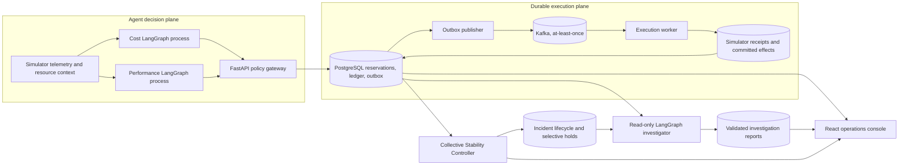
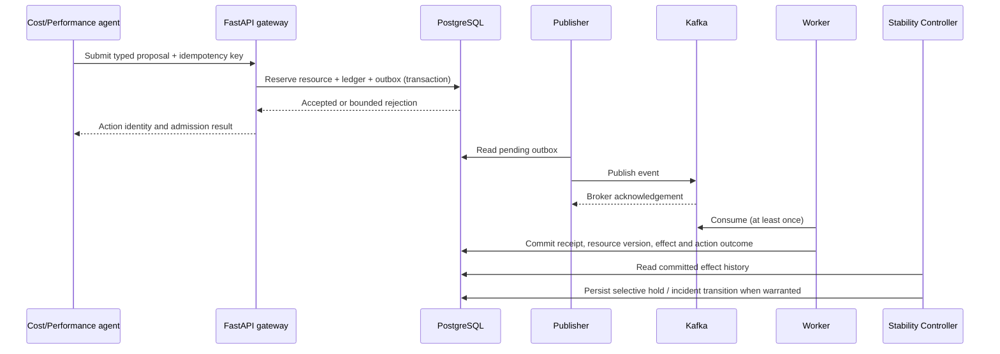
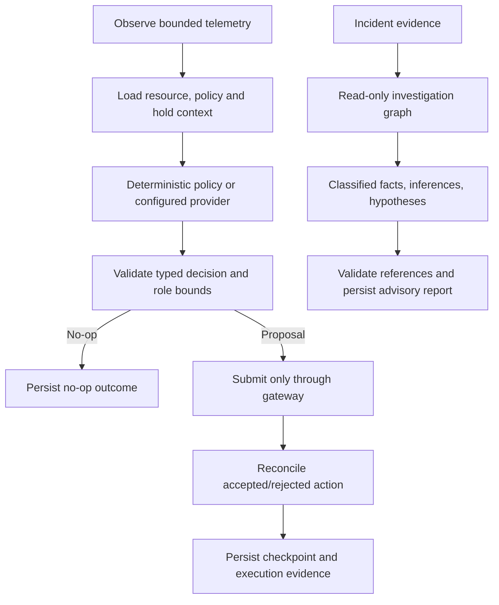

# BotKernel Portfolio Walkthrough

## What the system demonstrates

BotKernel explores a specific distributed-systems problem: independently valid agents can interfere when they optimize a shared resource. It combines deterministic Cost and Performance policies, LangGraph workflow state, a PostgreSQL admission/outbox boundary, at-least-once Kafka delivery, idempotent simulator receipts, and a Collective Stability Controller that reasons over committed effects. Investigation reports use persisted evidence and remain read-only.

The model-reasoning boundary is explicit. Deterministic policies and the deterministic investigator are the verified defaults. The optional Bedrock Converse provider is implemented and offline-tested, but **no live inference has been verified**. A guarded three-case acceptance runner is prepared; it is not authorization or evidence of live model quality. LLM recommendations cannot bypass gateway admission or controller policy, and AI infrastructure action execution remains disabled.

## Architecture

PostgreSQL is authoritative for reservations, action state and committed effects. Redis carries advisory heartbeats. Kafka delivery is at least once; simulator receipts and durable ledger reconciliation prevent duplicate committed simulator effects for a logical action. This is not a claim of exactly-once behavior for arbitrary external side effects.

## Distributed action sequence

The outbox makes gateway acceptance and publication intent atomic. The publisher can publish a duplicate after an acknowledgement/marking interruption; the worker reconciles through durable receipts. Action admission and controller checks remain the mutation authority.

## LangGraph and model boundary

Future Nova Micro inference requires a separately approved, bounded experiment. Provider provenance must identify actual calls; deterministic output must never be presented as LLM reasoning.

## Collective reliability and investigation

The controller orders committed effects by resource version and detects configured reversal/interference patterns. It can apply selective holds, verify sustained recovery, reopen on recurrence and escalate within its bounded policy. A graph edge inferred from a reversal is a deterministic relationship between persisted events, not proof that one agent caused another agent's behavior.

The investigator loads an actual persisted incident, committed effects and lifecycle evidence through bounded read-only queries. It returns a validated, durable report with referenced action/effect IDs and explicit uncertainty. It does not submit actions, resolve incidents or alter controller policy.

## Reproducible local demonstration

See [DEMO_WALKTHROUGH.md](DEMO_WALKTHROUGH.md). The bounded `botkernel.live_demo` command runs a deterministic single-process driver with two registered identities; it is **not** two independent autonomous agent processes. On the isolated `botkernel-bedrock-e2e` project, it submitted eight gateway actions for `service-b`, exercised real PostgreSQL outbox, Kafka, worker, controller and investigator paths, and produced a persisted incident and report. Every reported action was SUCCEEDED and cross-checked against the ledger, committed effect history and graph API.

Verified run identifiers from this local demonstration:

- Incident: `2` (`service-b`; later controller state VERIFIED with one recurrence and two interventions).
- Primary deterministic investigation: `d9d33cca-4c5a-4eb8-8dc3-0a23a7ac2c23` (COMPLETE, `deterministic_mock`).
- Idempotent POST replay returned the same investigation identity; GET returned the persisted report.
- Eight committed actions/effects were observed at versions 5-12. The complete action IDs and capacity sequence are in the latest `docs/PROJECT_HANDOFF.md` entry.

This is local simulator evidence, not a cloud-hosted incident and not a throughput benchmark.

## Benchmark honesty

`botkernel.evaluation` and the Experiment Lab contain seeded discrete-event simulator evaluations. Their metrics describe modeled scenarios, not PostgreSQL/Kafka throughput or production controller accuracy. Episode-level scoring complements, rather than replaces, tick occupancy. In five modeled oscillation seeds, basic and collective episode precision/recall were 0.143/1 and 0.333/1 respectively; collective had longer simulated holds and higher simulated p95 latency. These small modeled comparisons are not universal superiority claims.

A separate bounded local benchmark exercises the actual FastAPI, PostgreSQL outbox, Kafka and simulator-worker path. One 50-action, concurrency-5 run observed admission p50/p95/p99 of 269/666/892 ms, polled completion 1313/2212/2379 ms, and 3.585 committed effects/s. One worker interruption/replay recovered in 6.474 seconds with one committed effect. These are single runs on a shared local host, not production capacity estimates; internal phase times and workload resource peaks were not measured. Raw samples, other workloads, environment and limitations are in [BENCHMARKS.md](BENCHMARKS.md) and [BENCHMARK_AUDIT.md](BENCHMARK_AUDIT.md).

## Interview walkthrough (about five minutes)

1. Start with the shared-resource interference problem and explain why individually reasonable agents can oscillate.
2. Show Mission Control and distinguish simulated resource capacity from host CPU/memory.
3. Open the Effect Graph and trace versioned committed actions; distinguish observed modifications from inferred reversals.
4. Walk through gateway admission, PostgreSQL transactional outbox, Kafka at-least-once publication and receipt-based worker idempotency.
5. Open incident `2`, explain the two controller interventions, recovery verification and recurrence, then open its persisted deterministic report and follow a cited action back to graph evidence.
6. State limits plainly: current investigation is deterministic, live Bedrock is unverified, the operator console is private/unauthenticated, and seeded Experiment Lab data is not a production-performance claim.

## Resume bullet candidates

- Built a local-first multi-agent reliability platform with independent LangGraph workflows, PostgreSQL-backed action admission and transactional outbox, Kafka at-least-once processing, idempotent simulator receipts, and versioned committed-effect evidence.
- Implemented a deterministic Collective Stability Controller that detects cross-agent resource reversals, applies selective holds, verifies recovery, tracks recurrence, and produces evidence-grounded read-only investigation reports.
- Deployed a private single-host AWS demo on EC2 with encrypted persistent storage, private ECR, SSM-only operator access, Docker Compose services, and a React/TypeScript operations console; live Bedrock inference remains separately gated and unverified.

Tailor each bullet to the target role and retain the simulator/AWS-demo qualifications where relevant.
